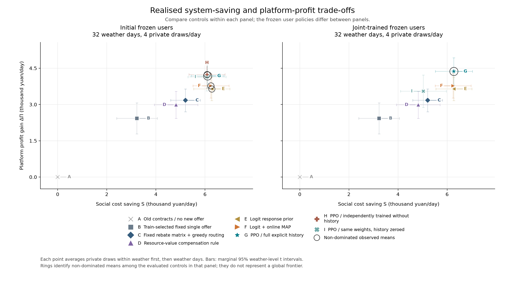

# 电—碳—算力任务合同协同

保存日期：2026-10-29。本仓库保存当前仿真框架、训练模型、原始结果、图表和复算入口。

研究问题：面对输电拥塞和碳约束，平台如何通过分区、分时的执行合同与补偿，引导用户自愿迁移或延迟任务，在完成相同任务量的条件下降低系统运行成本？

## 当前机制与四个智能体

- 平台逐任务公布一份合同，指定目标区域、执行时段和额外回扣；三个用户分别决定接受，或保留已接受的旧合同。
- 一个平台 PPO（61 个动作）与三个独立用户 PPO（二元动作）。平台每天决策 12 次，每个用户决策 4 次。
- 输电网通过 OPF 计算调度与节点电价；发电侧碳政策价固定为 100 元/吨，共同碳总量约束的影子价格内生计算。
- 这些是允许按任务变化的合同报价。本轮没有施加所有用户共享同一分区分时价表的条件。
- 用户的时间敏感度和迁移不便成本是私有参数；平台观察公开状态和实际接受/拒绝反馈。

资源节约记为 G，新增用户回扣为 R，净采购节约 M=G−R。平台利润增量为 0.8M，采购账户保留 0.2M。用户增量效用 U=R−新增不便成本，真实社会节约 S=M+U。平台按实际现金收益训练，用户按自身实际效用训练，折扣因子均为 1。

## 最新正式测试结果

根算法种子为 0；32 个独立公开天气场景，每个配 4 组私有意愿。下表为匹配联合用户组的日均结果。各方法完成相同任务量，均满足截止时间、用户参与条件、旧平台收益底线和共同碳上限。

| 方法 | 社会运行成本节约（元/日） | 平台利润增量（元/日） | 全网减排（吨CO₂/日） |
|---|---:|---:|---:|
| 保留旧合同 | 0.00 | 0.00 | 0.000 |
| 固定单合同 | 3228.54 | 2423.21 | 1.301 |
| 固定价表＋动态路由 | 5205.98 | 3170.30 | 0.347 |
| 资源节约比例规则 | 4822.53 | 2984.66 | 0.612 |
| 经验接受概率规则 | 6274.79 | 3641.87 | 1.041 |
| 经验概率＋在线更新 | 6242.52 | 3768.77 | 0.893 |
| 联合训练 PPO | 6275.29 | 4366.25 | 0.613 |
| 联合 PPO：清空显式历史 | 5033.79 | 3545.28 | 0.477 |

成本节约包含用户不便成本；利润是相对旧合同的增量。固定容量成本为 2,211,840 元/日，当前低利用率仿真下总账面利润仍为负。

PPO 相对较强动态规则的系统成本节约基本持平，优势主要体现在平台收益。全网减排与算力中心分摊碳足迹分别记录：联合 PPO 的全网减排约 0.613 吨/日，但算力中心分摊碳足迹增加约 3.073 吨/日。本轮未单独运行“仅感知电价”与“共同感知电碳”的消融比较。

完整逐方法碳指标见 [碳与性能对照](seed0/methods_carbon_comparison.txt) 和 [CSV](seed0/methods_carbon_comparison.csv)。



## 训练与对照

先在多样合同下训练用户，再分别训练带显式历史、无显式历史的平台 PPO，随后进行四主体交替训练。本次历史运行的平台预算为每个版本 131,072 步，联合更新实际完成 4 轮，按验证集平均 M 选中第 2 轮。后续默认一个根种子、先一轮联合更新，验证持续改善后再追加。

固定单合同在 61 个候选中选择，固定价表在 204 个模板中选择，资源节约比例在 6 个候选中选择。接受概率规则使用实际已发报价的响应拟合；另有基于当天反馈的在线更新规则。参数选择使用训练场景，PPO 检查点使用验证场景，最终测试独立。

固定预训练用户阶段另有“同一 PPO 清空显式历史”及“独立训练无历史 PPO”两个对照。不同用户组的结果分开报告。四个私有意愿样本先在同一公开天气内平均，再进行天气级配对统计；它们不是多个算法随机种子的重复实验。

## 文件入口

| 路径 | 内容 |
|---|---|
| `source/` | 完整运行源码、配置和测试 |
| `seed0/结论.txt` | 当前结论 |
| `seed0/报告.txt` | 全部方法、指标与配对比较 |
| `seed0/experiment_plan.json` | 抽样、动作、奖励与训练预算 |
| `seed0/baselines-initial/` | 固定初始用户下的对照与原始结果 |
| `seed0/baselines-joint/` | 匹配联合用户下重选的基准与测试结果 |
| `seed0/full-history/`、`seed0/no-history/` | PPO 检查点与训练记录 |
| `inputs/` | 固定旧制度和用户热启动模型 |
| `logs/` | 本次运行与测试日志 |
| `runtime_requirements.txt`、`runtime.json` | 依赖版本与环境信息 |

## 复算

本次运行使用 Python 3.12。源码和模型所需依赖版本记录在 `runtime_requirements.txt`。

```bash
python -m venv .venv
source .venv/bin/activate
python -m pip install -r runtime_requirements.txt

# 读取保存的模型，复算最终测试与图表
python reproduce.py --mode replay

# 从固定输入重新训练；未来默认只做一轮联合更新
python reproduce.py --mode train --workers 4 --joint-cycles 1
```

输出分别位于 `replayed/seed0/` 和 `retrained/seed0/`。若需复现本次历史四轮预算，可显式指定 `--joint-cycles 4`。模型加载时在新输出目录重建路径，保存的原始模型保持可追溯。

协调模块测试已完成：533 项通过；另有并行基准选择等价测试与可视化检查。源码、固定输入及数据表的校验记录见 `source_snapshot.json` 和 `artifact_manifest.json`。

## 上游来源

基于 [CLAIR-LAB-TECHNION/energy-net](https://github.com/CLAIR-LAB-TECHNION/energy-net) 修改，参考基线提交 `a55083828ad4a484e44575b579a448cde3a4466a`。

参考论文：[Multi-Agent Reinforcement Learning for Modeling, Simulating, and Optimizing Energy Markets](https://ojs.aaai.org/index.php/AAAI/article/view/41229)。保留上游 [LICENSE](LICENSE) 与 [原项目 README](source/README.md)。当前任务、硬件、风光负荷和偏好数据为仿真设定。
